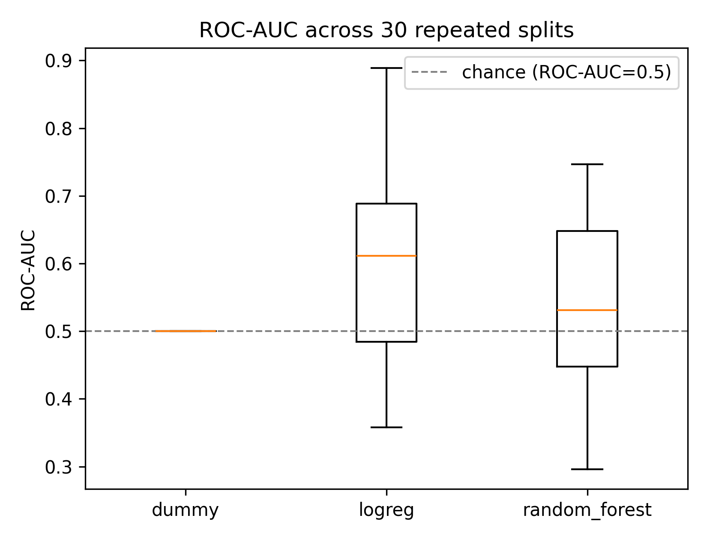
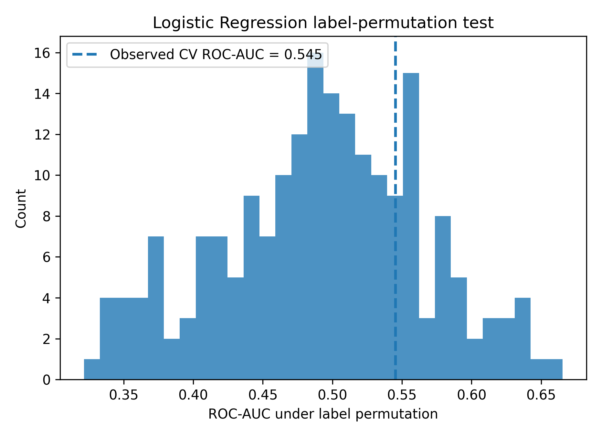
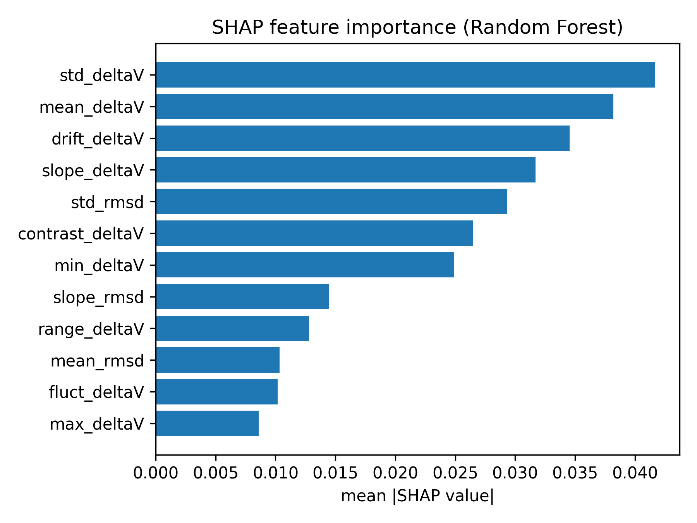

# Protein Simulation Stability Analysis

[](https://github.com/annemcq/protein-simulation-stability-analysis/actions/workflows/tests.yml)

Machine-learning analysis of whether early energy and structural signals from molecular simulations can help predict later deviation from expected thermodynamic behaviour.

The main question was:

> Can information from the beginning of a simulation help identify systems that are likely to behave abnormally later?

## Dataset

The analysis uses molecular simulation data from approximately 90 protein systems.

For each system, energy trajectories were available for three components:

- protein complex
- complex without peptide
- peptide

These were combined into an interaction-energy trajectory:

$$
\Delta V(t) = E_{\mathrm{complex}} -
(E_{\mathrm{nopep}} + E_{\mathrm{pep}})
$$

Structural trajectories were also available and used to calculate RMSD-based features.

Only the first 20% of each trajectory was used for feature extraction, so that the models only had access to information from the early part of the simulation.

The supplied processed CSVs contain **96 energy-feature systems**, **126 structural-feature systems**, and **95 target-table systems**, each with a unique normalised `pdb` key. Inner joining all three tables on this key leaves **90 systems** (the 90 IDs common to all three tables). This is an intersection of identifiers, not a claim that additional trajectories were excluded during feature extraction. I removed the lowest and highest 1% of the target distribution (`Perp_dist`) before defining the median split, which removed 2 systems and left 88 systems for analysis.

## Features

Energy features summarize the early ΔV trajectory:

- mean and standard deviation
- minimum, maximum and range
- slope
- drift
- contrast between different parts of the early trajectory
- fluctuation ratio

Three structural features were calculated from RMSD relative to the first trajectory frame:

- mean RMSD
- RMSD standard deviation
- RMSD slope

The final models use 12 features in total.

### Feature definitions and reproducibility status

For the early interaction-energy series $v_i = \Delta V_i$, let $n$ denote the number of frames **used for the early-window summary**. The definitions below separate **relations verified from the committed numeric table**, conventional interpretations, and unverified inferences. There is no original energy-extraction implementation or raw energy trajectory in this repository.

| Column | Definition or numerical relation | Evidence |
|---|---|---|
| `mean_deltaV` | $`\bar v = \sum_i v_i/n`$ | Conventional interpretation of name; raw-data calculation unavailable |
| `std_deltaV` | $`\sqrt{\sum_i(v_i-\bar v)^2/n}`$, or its sample-standard-deviation variant | Conventional interpretation; `ddof` unknown |
| `min_deltaV`, `max_deltaV` | Minimum and maximum of the early series | Conventional interpretation |
| `range_deltaV` | $`\max(v)-\min(v)`$ | **Verified exactly** for all 96 committed rows |
| `slope_deltaV` | A linear trend in $`\Delta V`$, plausibly least-squares slope against frame index | Inferred; exact time/index convention unverified |
| `drift_deltaV` | Difference between later and earlier segment means; approximately consistent with last-half minus first-half | **Inferred, not recovered exactly**; relationship to slope suggests segment-centre separation ≈99 frames |
| `contrast_deltaV` | Difference between separated segment means; approximately consistent with last ≈30% minus first ≈30% | **Inferred, not recovered exactly**; relationship to slope suggests separation ≈137 frames |
| `fluct_deltaV` | $`\frac{\mathrm{std\_deltaV}}{\lvert\mathrm{mean\_deltaV}\rvert}`$ | **Numerically verified** for all 96 rows to maximum absolute difference 0.00155, consistent with rounding |
| `mean_rmsd`, `std_rmsd`, `slope_rmsd` | Mean, population standard deviation and least-squares slope of RMSD against early-frame index | Implemented in `src/extract_rmsd_features.py` |

The supplied energy-feature CSV reports `n_frames = 1000` for every system. The original pipeline says it uses the first 20% of each simulation, suggesting 200 early frames for a 1,000-frame trajectory, **but the meaning of `n_frames` and exact extraction operations cannot be independently established without the missing raw-data code**.

**Units:** The repository does not state the energy unit or the physical reference state of its energy traces. If all input energies use the same physical energy unit, the additive summary statistics above carry that unit; the slope would carry that unit per frame if regressed against frame index. The fluctuation ratio defined above is dimensionless. MDTraj reports RMSD in nanometres; the script's mean and standard deviation are therefore in nm, and its slope is in nm/frame index if frames were sampled at equal increments. No physical time step is documented.

### Target definition (verified from the committed target CSV)

Let $x=\mathrm{Ref\_rank}$ and $y=\Delta G_{\mathrm{fep}}$. An ordinary least-squares regression of $y$ on $x$ across the **95 rows in the target table** gives

$$
\widehat y = a + bx,\qquad
a = -42.2328382575,\qquad b = 0.0174392514.
$$

The table's `Fit_ŷ` agrees with this fitted line to numerical precision. The remaining columns satisfy

$$
\mathrm{Residual} = \Delta G_{\mathrm{fep}} - \widehat y,\qquad
\mathrm{Perp\_dist} = \frac{|\mathrm{Residual}|}{\sqrt{1+b^2}}.
$$

These relations reproduce the committed target data to about $10^{-14}$. Their interpretation is therefore established from the numeric table **even though the upstream script was not provided**. The sample correlation between `Ref_rank` and `ΔG_fep` is only about **0.0406**, so the fitted line is almost flat. Thus `Perp_dist` is essentially absolute distance from a near-constant fitted free-energy level, **not evidence of a strong expected free-energy trend**. The units of this geometric distance depend on the plotted coordinate scales and are not an independently verified physical energy unit.

`ΔG_fep` is labelled as a computed free-energy estimate and `σ(ΔG)` as its bootstrap uncertainty; the reference state and units are not supplied. `Ref_rank` is a reference ranking coordinate, but how it was originally generated is undocumented. These provenance gaps should remain explicit.

For model training, the three input tables are inner-joined by normalised `pdb` ID (96 energy rows, 126 structural rows, 95 target rows → 90 matched systems); after excluding values outside the 1st and 99th `Perp_dist` percentiles, **88 systems** remain. Their `Perp_dist` median is **8.4044**, producing 44 observations per class.


## Target

The prediction target is derived from `Perp_dist`, which measures deviation from a fitted ΔG relationship.

Systems below the median `Perp_dist` are assigned to the low-deviation class and systems above the median to the high-deviation class.

After preprocessing, the final dataset contains 44 systems in each class.

## Models

I compared three models:

- Dummy classifier
- Logistic Regression
- Random Forest

Logistic Regression uses standardized features. The Dummy classifier provides a baseline for determining whether the trajectory features contain useful predictive information.

ROC-AUC is used as the main evaluation metric.

## Evaluation strategy

I initially evaluated the models using a single stratified 80/20 train/test split (**ROC-AUC 0.543 for Logistic Regression and 0.549 for Random Forest**, based on the reported original split). These are **not** the 30-holdout means reported below. Because the test set contains only 18 systems, the resulting ROC-AUC is sensitive to which observations happen to be held out.

I therefore added two complementary resampling analyses.

### Repeated evaluation

I compared 30 repeated stratified 80/20 holdout splits with 30 repeated stratified 5-fold cross-validation runs for Logistic Regression:

| Protocol | Mean ROC-AUC | Std | Median | Range |
|---|---:|---:|---:|---:|
| 30× stratified 80/20 holdout | **0.597** | 0.137 | 0.611 | 0.358–0.889 |
| 30× repeated 5-fold CV | **0.545** | 0.038 | 0.548 | 0.463–0.606 |

The holdout estimate is higher but substantially more variable. The repeated 5-fold estimate is more stable because every observation contributes to out-of-fold evaluation across the repeated partitions.

This makes the repeated 5-fold estimate the more appropriate primary performance summary for this small dataset.

To compare **all three models under the same repeated 5-fold protocol**, I evaluated Dummy, Logistic Regression, and Random Forest on 30 seeded five-fold partitions. Each repeat calculates ROC-AUC from pooled out-of-fold probabilities. The results were:

| Model | Mean ROC-AUC | Std | Median | Range |
|---|---:|---:|---:|---:|
| Dummy (most frequent) | 0.489 | 0.000 | 0.489 | 0.489–0.489 |
| Logistic Regression | **0.545** | 0.038 | 0.548 | 0.463–0.606 |
| Random Forest | 0.514 | 0.035 | 0.514 | 0.450–0.589 |

Random Forest is only slightly above the dummy baseline in mean ROC-AUC (0.514 vs. 0.489). These descriptive results do not establish a statistically significant advantage: the same 88 systems recur across the 30 partitions. Logistic Regression also remains close to chance, consistent with the permutation test reported below. The dummy's pooled ROC-AUC is 0.489 rather than exactly 0.5 because the metric is computed on pooled out-of-fold predictions, not separately within each fold.

Reproduce this comparison with `python src/compare_resampling_protocols.py`, which writes `results/repeated_5fold_model_comparison.csv`. The protocol-comparison table above applies to Logistic Regression only.



### Label-permutation test

To test whether the observed Logistic Regression performance could arise from arbitrary associations between features and labels, I performed a label-permutation test using the same repeated 5-fold protocol as the primary evaluation.

The observed mean ROC-AUC was **0.5454**. Across 200 label permutations, the null distribution had a mean of **0.4921**, standard deviation **0.0737**, and 95th percentile **0.6147**.

The permutation p-value was **0.2438**.



The one-sided permutation p-value uses the standard +1 correction: (1 + number of permuted scores at least as large as observed) / (200 + 1) = 49/201 = 0.2438.

Thus, the observed performance is not sufficiently separated from the permutation null distribution to reject the hypothesis that the apparent predictive signal could be explained by chance.

The permutation test uses 200 permutations because each permutation repeats the full 30×5-fold evaluation protocol. This is an intentionally computationally heavier robustness check rather than a claim of high-precision p-value estimation.

### Statistical interpretation

The earlier paired Wilcoxon comparisons across repeated 80/20 splits remain useful for describing differences between resampling runs, but they should not be interpreted as independent experimental evidence because all repeats reuse the same 88 systems.

Taken together, the more conservative interpretation is that **the current dataset does not provide convincing evidence that the trajectory-derived features have reproducible predictive power for the stability label**.


## Feature interpretation

The original analysis used the Random Forest's impurity-based feature importance. Energy-derived variables such as drift, mean and slope of ΔV appeared among the most important features.

I later repeated the interpretation using SHAP values calculated on a held-out test split.



The highest mean absolute SHAP values were associated with:

| Feature | Mean \|SHAP value\| |
|---|---:|
| `std_deltaV` | 0.0416 |
| `mean_deltaV` | 0.0382 |
| `drift_deltaV` | 0.0346 |
| `slope_deltaV` | 0.0317 |
| `std_rmsd` | 0.0293 |

The energy-derived features remain prominent, while the simple RMSD summaries contribute less overall.

However, these importances should be interpreted cautiously. The Random Forest did not consistently outperform the dummy baseline across the repeated splits; because those splits reuse the same 88 systems, this comparison is descriptive rather than independent evidence of a performance difference. The SHAP analysis therefore describes what this particular model relies on rather than establishing these features as biological predictors of simulation stability.

## What I learned

The main result of the project was not a high-performing classifier. Instead, the analysis showed how easily conclusions can change when working with a small scientific dataset.

The original single holdout yielded ROC-AUC 0.543 (Logistic Regression) and 0.549 (Random Forest), whereas the **30 repeated holdouts** averaged 0.597 for Logistic Regression. Repeated 5-fold cross-validation reduced this to **0.545 ± 0.038 ROC-AUC**. The label-permutation test also failed to reject the null hypothesis (**p = 0.244**).

Adding simple RMSD-based structural features did not produce a strong predictive model, and the Random Forest did not show a clear improvement over the dummy baseline.

Overall, the current data do not provide convincing evidence that early trajectory summaries can reliably predict later simulation stability. More detailed structural representations, time-dependent features, stronger validation on independent systems, or a larger dataset would be needed before using this type of model for reliable early stopping of simulations.

## Repository structure

```text
protein-simulation-stability-analysis/
├── data/
│   ├── project3_energy_features.csv
│   ├── project3_structure_features.csv
│   ├── project3_final_dataset.csv
│   └── rank_by_distance_to_fit_deltaG_fep_BOOTSTRAP.csv
│
├── results/
│   ├── model_comparison.png
│   ├── repeated_eval_all_results.csv
│   ├── repeated_eval_boxplot.png
│   ├── paired_significance_roc_auc.csv
│   ├── logreg_permutation_null.csv
│   ├── logreg_permutation_test.csv
│   ├── logreg_permutation_test.png
│   ├── repeated_5fold_model_comparison.csv
│   ├── resampling_protocol_comparison.csv
│   ├── shap_feature_importance.csv
│   └── shap_feature_importance.png
│
├── src/
│   ├── build_dataset.py
│   ├── __init__.py
│   ├── extract_rmsd_features.py
│   ├── train_models.py
│   ├── repeated_cv_evaluation.py
│   ├── compare_resampling_protocols.py
│   ├── permutation_test.py
│   └── shap_analysis.py
│
├── tests/
│   ├── test_models_and_stats.py
│   └── test_processed_data_provenance.py
│
├── .github/workflows/tests.yml
├── LICENSE
├── pytest.ini
├── requirements.txt
└── README.md
```

## Reproducing the analysis

Install the dependencies (currently minimum-version constraints rather than an exact reproducible lockfile):

```bash
pip install -r requirements.txt
```

Rebuild the final dataset from the processed feature tables:

```bash
python src/build_dataset.py
```

Run the original single-split analysis:

```bash
python src/train_models.py
```

Run the 30-split evaluation and statistical comparisons:

```bash
python src/repeated_cv_evaluation.py
```

Compare the repeated 80/20 holdout and repeated 5-fold protocols:

```bash
python src/compare_resampling_protocols.py
```

Run the label-permutation test:

```bash
python src/permutation_test.py
```

This permutation test repeats 30 five-fold CV runs for each of 200 label permutations and can take substantially longer than the other analyses.

Run the SHAP analysis:

```bash
python src/shap_analysis.py
```

Run the tests:

```bash
python -m pytest
```

## Data availability

The processed datasets required to reproduce the model training and evaluation are included in the repository.

The original molecular simulation trajectories and raw energy time series are unpublished data generated as part of the author's research. They are intentionally not distributed in this public repository at this stage. `src/extract_rmsd_features.py` documents **only RMSD** feature extraction and requires access to the original trajectories. The nine energy features were supplied as `data/project3_energy_features.csv`; their extraction implementation is absent. Therefore, the modelling analysis can be reproduced from the committed tables, but the full raw-trajectory-to-features pipeline cannot.

**Data provenance:** Three processed inputs are committed under `data/`: `project3_energy_features.csv` (96 rows), `project3_structure_features.csv` (126 rows) and `rank_by_distance_to_fit_deltaG_fep_BOOTSTRAP.csv` (95 rows). The original trajectories were generated as part of the author's research and are not publicly available. Any future release should respect relevant research-group, collaborator and institutional agreements. The trajectory generation protocol, energy units and original raw energy-feature construction code are not supplied, so end-to-end reproduction from raw simulation data is not yet possible. This restriction does not prevent reproduction of the downstream analysis from the committed processed tables.

## Limitations

This is a small dataset, with 88 systems in the final analysis. The variability across repeated splits reflects that limitation.

The binary target is also a simplification of a continuous quantity (`Perp_dist`). A larger dataset could make direct regression on this quantity more useful.

Finally, the structural representation used here is deliberately simple. Global RMSD statistics cannot capture many local conformational changes or interaction patterns that may be relevant to simulation stability.

Possible extensions would include contact-based structural features, residue-level interaction descriptors or models that use the trajectory as a time series rather than reducing it to summary statistics.

## Tools

Python, NumPy, pandas, scikit-learn, SciPy, MDTraj, SHAP and matplotlib.

## License

This project is available under the MIT License.
